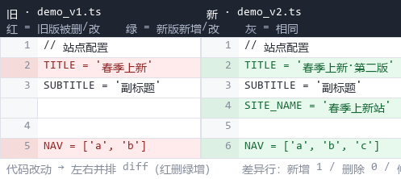
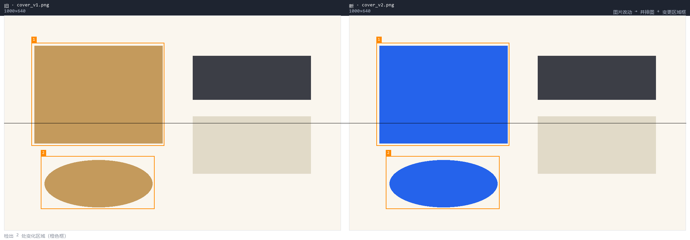
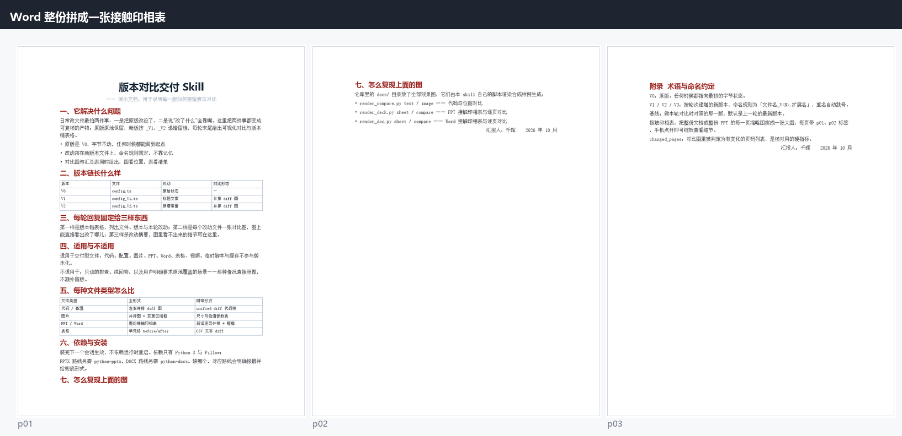
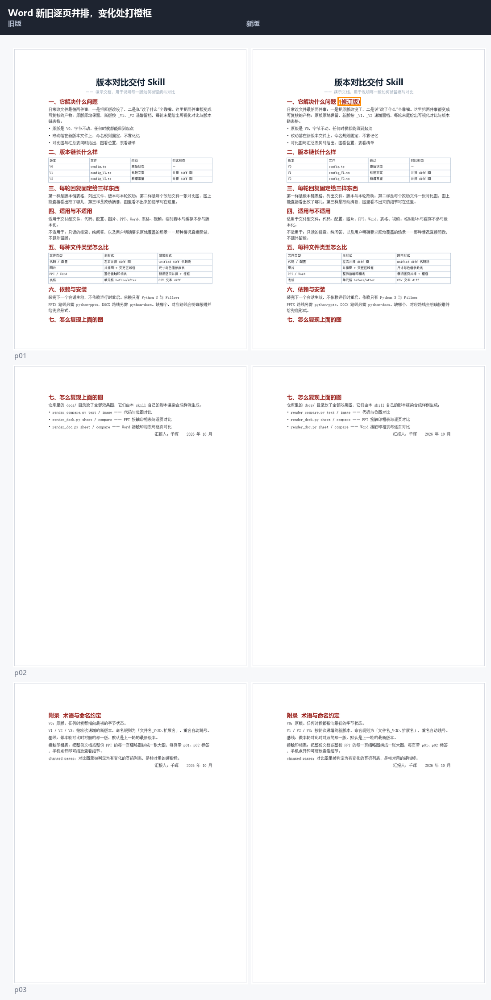

# version-diff-delivery · 版本对比交付

<div align="center">

**改任何文件，都留下三样东西：原版不动 · 递增版本 · 看得见的前后对比。**
**Every edit leaves three things behind: the original, an incremented version, and a visual diff.**

[English](#english) · [中文](#中文)

</div>

---

## 效果图 / Screenshots

以下图片全部由本仓库自己的脚本渲染合成样例生成；样例素材与一键复现脚本在 `docs/samples/`。

All images below were rendered by this repo's own scripts from synthetic samples; the samples and a
one-command reproduction script live in `docs/samples/`.

### 代码 / 配置 · 代码与配置

| 左右并排 diff（红删绿增，带行号） | 位图并排 + 橙色变更区域框 |
|---|---|
|  |  |

### PPT · 演示文稿

| 整份拼成一张接触印相表 | 新旧逐页并排，变化处打橙框 |
|---|---|
|  |  |

### Word · 文档

| 整份拼成一张接触印相表 | 新旧逐页并排，变化处打橙框 |
|---|---|
|  |  |

> 接触印相表（contact sheet）＝把整份文档／整份 PPT 的每一页缩略图拼成**一张**大图，每页带 `p01`、`p02` 标签，手机点开即可缩放看细节。
> A contact sheet packs every page of a document or deck into **one** image, labelled `p01`, `p02`… — tap it on a phone to zoom in.

---

## 中文

### 它解决什么问题

日常改文件最容易出两类事故：**把原版改没了**，以及**说"改了什么"全靠嘴**。
这个 skill 把两件事都变成可复核的产物：

1. **原版永不覆盖** —— 原始文件原地不动，视为 `V0`。
2. **改动另存递增版本** —— 新版本写在同目录，命名 `文件名_V1.扩展名`、`_V2`……重名自动跳号。
3. **每轮结尾给可视化对比** —— 每个改动文件一张对比图 + 一张版本链汇总表。

**触发时机**：只要 agent 改动了任何文件并要汇报结果，本 skill 就该上场。
只读排查、纯问答不改文件的场景不触发。

### 安装

```bash
git clone https://github.com/H-u-iCN/version-diff-delivery.git ~/.minimax/skills/version-diff-delivery
```

Windows（PowerShell）：

```powershell
git clone https://github.com/H-u-iCN/version-diff-delivery.git "$env:USERPROFILE\.minimax\skills\version-diff-delivery"
```

装完**下一个会话生效**，不需要重启 runtime。
> 注意：clone 出来的目录名请保持 `version-diff-delivery`，与 skill 同名（这是 Mavis 解析 skill 的规则）。

离线分发也可以：把仓库目录打包成 zip，解压到 `~/.minimax/skills/` 下同样可用。

### 依赖

| 用途 | 依赖 |
|---|---|
| 全部路线 | Python 3 + Pillow |
| PPTX 路线 | python-pptx |
| DOCX 路线 | python-docx |

缺哪个，对应路线会明确报错并给兜底形式，不会静默跳过。

### 工作流程

1. **查基线** —— `version_file.py chain` 判定上一版是谁、下一版叫什么（脚本判定，不手算版本号）。
2. **开新版本** —— `version_file.py snap` 以基线为蓝本开出新版本工作副本，原版与所有旧版本不动。
3. **改** —— 所有编辑只发生在新版本文件上。
4. **渲染对比** —— 按文件类型选渲染模式，输出到项目内 `.mavis-compare/`。
5. **收尾** —— 版本链表格 + 每个改动文件一张对比图 + 改动摘要。

### 支持的文件类型

| 文件类型 | 主形式 | 附带形式 |
|---|---|---|
| 代码 / 配置 / Markdown / JSON / CSV | 左右并排 diff 图 | unified diff 代码块 |
| 位图（png/jpg/webp） | 并排图 + 变更区域框 | 尺寸与色值参数表 |
| PPTX | 整份接触印相表 | 新旧逐页并排 + 橙框 |
| DOCX | 整份接触印相表 | 新旧逐页并排 + 橙框 |
| 表格（xlsx/csv） | 单元格 before/after 表 | CSV 文本 diff |
| 视频 | 关键帧并排 | 时间码表 |

### 已知边界

- **页面图是近似渲染**：PPTX 用 python-pptx 读结构重画，DOCX 用 python-docx 按页边距流式排版，
  **不依赖 LibreOffice / Word / PowerPoint**。代价是分页、字距、阴影与真实引擎有出入——
  看"改了哪儿"完全够用，**不能当排版或视觉定稿依据**。
- **要真实版面**时需 LibreOffice（本机未装，`render_docx_pages.py` 会直接报 `Missing LibreOffice executable`），
  这时降级为结构／文本差异表，并注明"未能出图"，不拿文字表冒充图。

---

## English

### What it does

Two things go wrong constantly when editing files: **the original gets overwritten**, and
**"here's what changed" is just someone talking**. This skill turns both into inspectable artifacts:

1. **The original is never touched** — the source file stays put and is treated as `V0`.
2. **Edits land in incremented versions** — written next to the original as `name_V1.ext`, `name_V2.ext`…,
   automatically skipping taken numbers.
3. **Every round ends with a visual comparison** — one comparison image per changed file, plus a
   version-chain summary table.

**When it fires:** whenever an agent edits any file and reports the result. Read-only inspection and
Q&A that change no file are out of scope.

### Install

```bash
git clone https://github.com/H-u-iCN/version-diff-delivery.git ~/.minimax/skills/version-diff-delivery
```

Windows (PowerShell):

```powershell
git clone https://github.com/H-u-iCN/version-diff-delivery.git "$env:USERPROFILE\.minimax\skills\version-diff-delivery"
```

Takes effect in the **next session** — no runtime restart.
> Keep the cloned directory named `version-diff-delivery`; Mavis resolves a skill by its directory name.

Offline distribution works too: zip the repo and unpack it into `~/.minimax/skills/`.

### Requirements

| Purpose | Dependency |
|---|---|
| All routes | Python 3 + Pillow |
| PPTX route | python-pptx |
| DOCX route | python-docx |

If one is missing, that route fails loudly with a documented fallback — it never skips silently.

### Workflow

1. **Resolve the baseline** — `version_file.py chain` determines the previous version and the next
   filename (deterministic, never hand-computed).
2. **Open a new version** — `version_file.py snap` copies the baseline into a fresh version file;
   the original and every older version stay untouched.
3. **Edit** — all edits happen on the new version file only.
4. **Render** — pick the renderer by file type; output lands in the project's `.mavis-compare/`.
5. **Close out** — version-chain table + one comparison image per changed file + a change summary.

### Supported file types

| File type | Primary form | Secondary form |
|---|---|---|
| Code / config / Markdown / JSON / CSV | Side-by-side diff image | unified diff code block |
| Raster images (png/jpg/webp) | Side-by-side with change boxes | size & color parameter table |
| PPTX | Full-deck contact sheet | page-by-page comparison + orange boxes |
| DOCX | Full-document contact sheet | page-by-page comparison + orange boxes |
| Spreadsheets (xlsx/csv) | Cell-level before/after table | CSV text diff |
| Video | Key-frame pairs | timecode table |

### Known limits

- **Page images are approximate.** PPTX is re-drawn from `python-pptx` structures, DOCX is laid out by
  `python-docx` from the page margins — **no LibreOffice / Word / PowerPoint involved.** Pagination,
  kerning and shadows differ from the real engines: plenty for *seeing what changed*, **not** a
  typographic proof.
- **For true fidelity** you need LibreOffice (not installed here, so `render_docx_pages.py` fails with
  `Missing LibreOffice executable`); the skill then falls back to a structure/text diff table and says
  so, rather than passing off a text table as a rendered page.

---

## 仓库结构 / Repository layout

```
version-diff-delivery/            # ← 仓库根就是 skill 根（SKILL.md 在根，才能一行 clone 安装）
├── SKILL.md                      # skill 本体：触发条件 + 六步流程 + 交付契约
├── README.md                     # 给人看的这一页（你正在读）
├── LICENSE                       # MIT
├── references/
│   └── comparison-formats.md     # 按文件类型的对比形式选型表
├── scripts/
│   ├── version_file.py           # 版本链：chain / snap / list
│   ├── render_compare.py         # 文本 diff / 位图并排 / 页面对
│   ├── render_deck.py            # PPTX 页面渲染 + 接触印相表 + 新旧对比
│   ├── render_doc.py             # DOCX 页面渲染 + 接触印相表 + 新旧对比
│   └── sheetkit.py               # 拼图公共件
├── docs/
│   ├── demo-*.png                # 上面那些效果图
│   └── samples/                  # 合成样例 + 一键复现脚本
│       ├── make_demo.py          # 生成样例素材
│       ├── render_all.py         # 用本仓库脚本重渲全部效果图
│       └── demo_*.pptx / *.docx / *.png / *.ts
├── .gitattributes                # 跨平台统一 LF
└── .gitignore
```

复现上面所有效果图（在本仓库根目录执行）：

```bash
python docs/samples/render_all.py
```

> **关于 lint**：`skill-creator` 的 lint 规则不允许 skill 目录里出现 `README.md` 等面向人的文档，
> 而本仓库根目录同时是 skill 根目录（为了满足"仓库根必须含 `SKILL.md`"的安装约定），所以 lint 会报一条
> forbidden file。这**只影响该 lint 检查，不影响 skill 运行**（运行时只读 `SKILL.md` 与它引用的文件）。
> 想让安装目录绝对干净，clone 后删掉 `README.md` 与 `LICENSE` 即可。
>
> The `skill-creator` lint flags `README.md` inside a skill directory. This repo's root doubles as the
> skill root (required for the one-command install), so expect that single lint hit. It does **not**
> affect runtime — the runtime only reads `SKILL.md` and the files it references. Delete `README.md` and
> `LICENSE` after cloning if you want a strictly lint-clean install.

## 致谢 / Credits

页面渲染思路源自用户工程中的 `tools/render_preview.py`（python-pptx + Pillow 近似渲染），
本仓库将其通用化并补上了分组形状、图片失败可见化、分页、变更检测等能力。

The page-rendering approach originates from `tools/render_preview.py` in the user's own project
(python-pptx + Pillow approximation); this repo generalises it and adds group shapes, visible image
failures, pagination and change detection.

## 许可 / License

MIT — 见 [LICENSE](LICENSE)。
